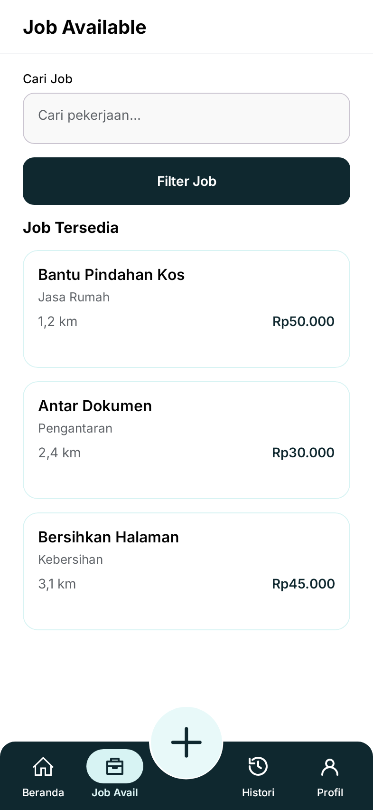
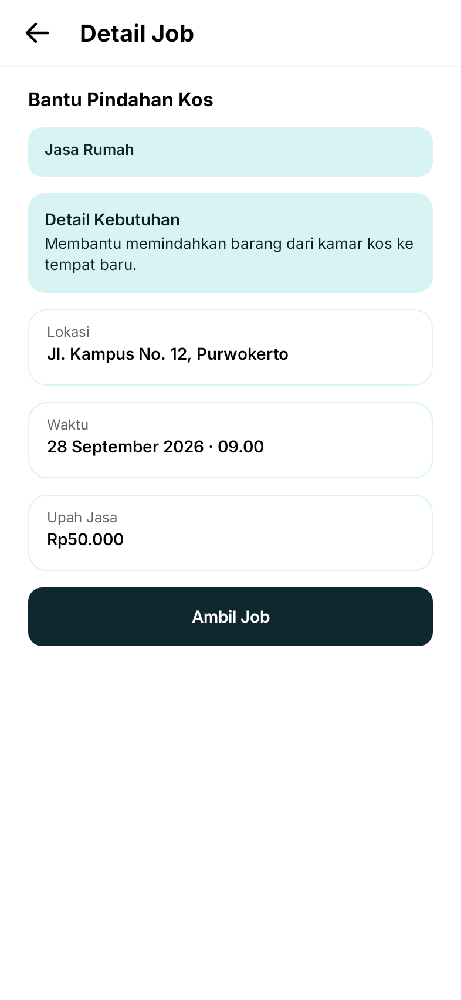

<div align="center">
  
  <br>
  
</div>

# Tulungin

Marketplace jasa tolong-menolong dan micro-tasking komunitas. Aplikasi utama sekarang menggunakan **Flutter** dengan target Android, iOS, dan Web. Implementasi Android Kotlin/Jetpack Compose lama tetap tersedia di folder `app/` sebagai fallback selama migrasi diuji.

## Fitur

- Daftar/masuk dengan email dan Google.
- Beranda, pencarian/filter job, detail, permintaan baru, lamaran dan pemilihan Penulung.
- Status pekerjaan, bukti kerja/pembayaran, konfirmasi, ulasan dan simulasi pembayaran.
- Chat job dan admin, tiket bantuan, profil dan unggahan foto.
- Peta lokasi OpenStreetMap serta dashboard admin untuk pengguna, job, kategori, dan chat.
- Firebase Authentication dan Cloud Firestore untuk data realtime.

| Beranda | Job Available | Detail Job |
| :---: | :---: | :---: |
|  |  |  |

## Menjalankan Flutter

Persyaratan: Flutter stable, Android SDK untuk Android, macOS + Xcode untuk membangun iOS, dan browser untuk Web.

```powershell
cd flutter_app
flutter pub get
flutter run
```

Petunjuk konfigurasi Firebase lintas platform, Google Sign-In, dan Cloudinary ada di [flutter_app/README.md](flutter_app/README.md).

Contoh build:

```powershell
cd flutter_app
flutter build apk
flutter build web
```

Build iOS harus dijalankan pada macOS:

```bash
cd flutter_app
flutter build ios
```

## Struktur

```text
Tulungin/
├── flutter_app/            # Aplikasi utama Flutter (Android, iOS, Web)
│   ├── lib/                 # UI, model, Firebase dan aturan alur
│   ├── android/
│   ├── ios/
│   └── web/
├── app/                     # Aplikasi Android Kotlin lama (fallback)
├── docs/                    # Desain, aset, dan verifikasi aplikasi Android lama
├── firestore.rules
└── README.md
```

Pembayaran tetap berupa simulasi; tidak ada uang yang ditagih. Unggahan gambar memerlukan unsigned upload preset Cloudinary. Firebase Rules harus dipublikasikan ke project Firebase sebelum memakai data produksi.
