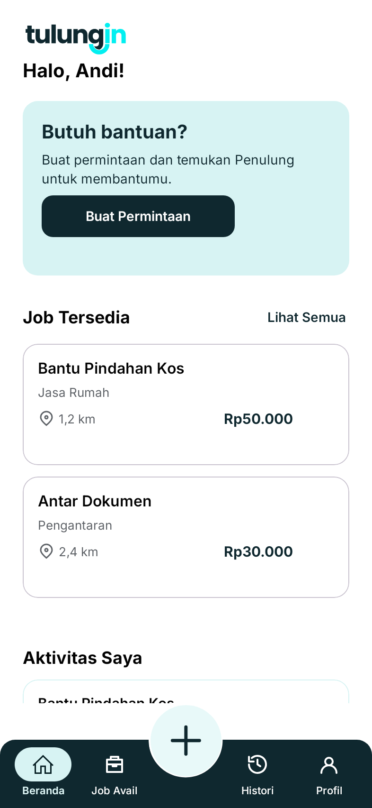

<div align="center">
  
  <br>
  
</div>

# Tulungin

Marketplace jasa tolong-menolong dan micro-tasking komunitas. Aplikasi utama menggunakan Flutter untuk Android, iOS, dan Web.

## Fitur

- Daftar/masuk dengan email dan Google.
- Beranda, pencarian/filter job, detail, permintaan baru, lamaran dan pemilihan Penulung.
- Status pekerjaan, bukti kerja/pembayaran, konfirmasi, ulasan dan simulasi pembayaran.
- Chat job dan admin, tiket bantuan, profil dan unggahan foto.
- Peta lokasi OpenStreetMap serta dashboard admin untuk pengguna, job, kategori, dan chat.
- Firebase Authentication dan Cloud Firestore untuk data realtime.

| Beranda | Job Available | Detail Job |
| :---: | :---: | :---: |
|  |  |  |

## Menjalankan aplikasi

Persyaratan: Flutter stable, Android SDK untuk Android, macOS + Xcode untuk membangun iOS, dan browser untuk Web.

```powershell
flutter pub get
flutter run
```

Contoh build:

```powershell
flutter build apk
flutter build web
```

Build iOS harus dijalankan pada macOS:

```bash
flutter build ios
```

### Firebase Android

Firebase Android membaca [android/app/google-services.json](android/app/google-services.json) untuk package `com.pemmob.tulungin`. Aktifkan Email/Password dan Google pada Firebase Authentication, dan daftarkan SHA-1/SHA-256 signing key Android untuk Google Sign-In.

Konfigurasi Web dan iOS belum tersedia di repository; buat masing-masing app di Firebase Console untuk mendapatkan nilainya. Jangan menaruh service-account key atau rahasia server di aplikasi klien.

### Firebase Web

Isi nilai dari Firebase Web App config saat menjalankan:

```powershell
flutter run -d chrome `
  --dart-define=FIREBASE_PROJECT_ID=your-project-id `
  --dart-define=FIREBASE_MESSAGING_SENDER_ID=your-sender-id `
  --dart-define=FIREBASE_WEB_API_KEY=your-web-api-key `
  --dart-define=FIREBASE_WEB_APP_ID=your-web-app-id `
  --dart-define=FIREBASE_AUTH_DOMAIN=your-project-id.firebaseapp.com
```

Tambahkan `--dart-define=FIREBASE_STORAGE_BUCKET=...` bila diperlukan, dan aktifkan domain pada Firebase Authentication.

### Firebase iOS

Buat iOS App dengan bundle ID `com.pemmob.tulungin`, tambahkan `GoogleService-Info.plist` ke Runner melalui Xcode, dan gunakan nilai konfigurasi Firebase iOS:

```bash
flutter run -d ios \
  --dart-define=FIREBASE_PROJECT_ID=your-project-id \
  --dart-define=FIREBASE_MESSAGING_SENDER_ID=your-sender-id \
  --dart-define=FIREBASE_IOS_API_KEY=your-ios-api-key \
  --dart-define=FIREBASE_IOS_APP_ID=your-ios-app-id \
  --dart-define=FIREBASE_STORAGE_BUCKET=your-project-id.firebasestorage.app
```

Build iOS memerlukan macOS dan Xcode. Untuk Google Sign-In, tambahkan URL scheme `REVERSED_CLIENT_ID` dari `GoogleService-Info.plist` ke Runner. Tambahkan `--dart-define=GOOGLE_IOS_CLIENT_ID=...` bila client ID perlu ditentukan eksplisit.

### Cloudinary

Unggahan foto memakai unsigned Cloudinary preset Tulungin: cloud name `ahvdebyq`, preset `tulungin_preset`. Nilai dapat dioverride ketika menjalankan atau build:

```powershell
flutter run `
  --dart-define=CLOUDINARY_CLOUD_NAME=your-cloud-name `
  --dart-define=CLOUDINARY_UPLOAD_PRESET=your-unsigned-preset
```

Unsigned upload tidak memerlukan API key atau API secret. Jangan menaruh signed upload secret di aplikasi klien.

## Struktur

```text
Tulungin/
├── android/          # Project host Android Flutter
├── ios/              # Project iOS Flutter
├── lib/              # UI, model, Firebase dan alur aplikasi
├── test/             # Unit tests
├── web/              # Project host Flutter Web
├── assets/           # Logo dan font
├── docs/             # Desain dan aset referensi
├── firestore.rules
└── README.md
```

Pembayaran tetap berupa simulasi; tidak ada uang yang ditagih. Firebase Rules harus dipublikasikan ke project Firebase sebelum memakai data produksi.
